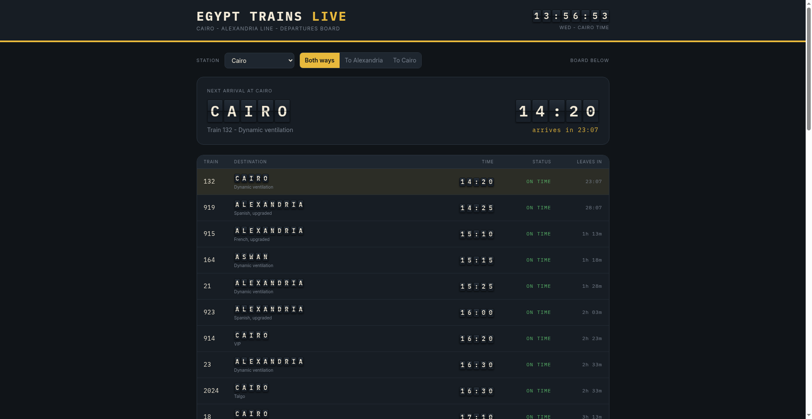

# Egypt Trains Live

A split-flap (Solari-style) departures board for the Cairo - Alexandria railway line, one of the busiest in Egypt. Pick any station on the line and the board shows every train calling there today, with live boarding status and a countdown that flips like a real station board.

**Live demo:** https://malakmo7amed309.github.io/egypt-trains/



## Standout feature

The board itself. Every destination, time and countdown is rendered as split-flap characters: when a value changes, each tile spins forward through the flap alphabet until it lands, with the classic horizontal split line and flip blur. The whole board ticks once a second against Cairo time, so statuses move from ON TIME to BOARDING to DEPARTED while you watch.

On top of the board there is a "Which train do I catch?" planner: choose any two stations on the line and it lists the next three direct trains, journey time and live countdown, with the best option flagged.

## What's inside

- 45 real trains each way-day on the Cairo - Alexandria line: Talgo, VIP, upgraded Spanish and French, sleeper, AC and ventilation services
- Schedules transcribed from the Egyptian National Railways operating schedule published 25 Nov 2026 (source: enr.gov.eg via press release of the same date)
- Correct handling of after-midnight arrivals and trains that only run on certain weekdays (sleeper services)
- All times computed in Africa/Cairo regardless of the viewer's timezone
- Planner works between any pair of the 17 stations, both directions

## Stack

React 19, Tailwind CSS 4, Vite (single-file build, no backend). No libraries for the flap animation - it is hand-rolled CSS and JS.

## Run locally

```bash
npm install
npm run dev
```

Build outputs a single self-contained `dist/index.html` (what GitHub Pages serves from `docs/`).

## Note

Timetables change. This is a portfolio project, not a travel tool - always confirm with ENR or at the station before travelling.
